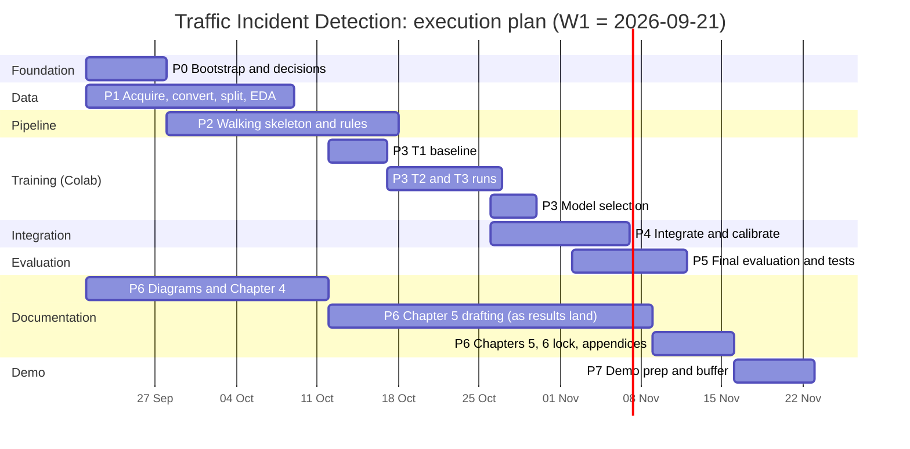

# 01. Master plan (end to end)

Anchor: **W1 = week of 2026-09-21.** The proposal timeline ends with a system demonstration in November 2026 (its Gantt image belongs to another project, so the dates are an assumption to confirm with the supervisor, see D-15 and the open question in the README). Buffer is built into W9.

## 1. Approach

Rapid Prototyping (proposal 3.2): build a thin working system early, evaluate it, refine, repeat. Four prototype cycles, each running the five stages (requirements, quick design, evaluation, refinement, implementation and testing). Documentation runs alongside every phase, not after.

The model arrives late by design. The pipeline is therefore built and tested on **COCO-pretrained YOLOv8n in stand-in mode** so that only the weights change when the Colab-trained model is dropped in (weights contract: `CLAUDE.md` section 6).

## 2. Phases and gates

| Phase | Name | Weeks | Objective | Gate (all must pass) |
|---|---|---|---|---|
| 0 | Foundation | W1 | Repo bootstrap, decisions D-01 to D-08 confirmed, env, interfaces, CI-style local checks | **G0 PASSED** (2026-09-22): `pytest` and `ruff` run green on the skeleton; decisions signed off; `requirements` installable on Python 3.10 |
| 1 | Data | W1 to W3 | Acquire, verify, convert, split, EDA | **G1 PASSED** (2026-10-02): `data/MANIFEST.json` complete (`yolo_ds_v1.tar` recorded, derived); YOLO dataset v1 built with sequence-level splits (16,427 UA-DETRAC images, 50 train / 10 val / 40 test sequences, leakage check clean; 3,000 DhakaAI images, 2,400/300/300 by perceptual-hash cluster); `stats.json` and `eda_insights.json` logged with figures; class map versioned (`class_map.json`, D-04 resolved); leakage check passes |
| 2 | Pipeline P0 | W2 to W4 | Seven modules working end to end in stand-in mode; behaviour rules with white-box tests | G2: video in, `incidents.csv` and annotated video out on 3 validation sequences (D-23) **run 2026-10-02 on real val sequences MVI_20011/MVI_40161/MVI_63553, see docs/logs**; unit and integration tests green; T0 zero-shot baseline **closed 2026-10-02 and 2026-10-03**: detector metrics on val (2,572 images) and dhaka_val (300) from `scripts/eval_detector.py`, run `20261002T202404Z_eval_t0_coco_standin` (val mAP50 0.377, mAP50:95 0.223), and pipeline latency on a 1,490-frame real clip, run `20261003T091505Z_coco_standin_latency_MVI_40161` (mean 498.6 ms per frame, 2.0 FPS); see `docs/logs/EVAL_LOG.md` |
| 3 | Training on Colab | W3 to W6 | Runs T1 to T3 (T4 optional), model selection | G3: runs logged with full manifest; best model exported with `model_card.json`; selection justified on val only. **Dataset ready (`data/processed/yolo_ds_v1.tar`, sha256 in MANIFEST.json); blocked only on the author running `notebooks/colab_train.ipynb` on Colab** |
| 4 | Integration and calibration | W5 to W7 | Drop weights in, verify, calibrate thresholds on val | G4: integration checklist passed; thresholds frozen in config (hash logged); FAR and recall trade-off curve recorded |
| 5 | Evaluation and testing | W7 to W8 | Five metrics, tracker check, stratified results, black-box and performance tests, one final test-split evaluation | G5: `eval_report.json` produced from a clean checkout; TEST_ACCESS_LOG entry; Chapter 5.5 table filled with verdicts |
| 6 | Documentation | W1 to W9 (lock W8) | Chapters 4 to 6, diagrams, appendices, Gantt fix, references fix | G6: chapter checklist in `06_DOCUMENTATION_PLAN.md` ticked; every number traced to a run ID |
| 7 | Demonstration | W9 | Demo script, rehearsed run, backup recording, viva Q&A prep | G7: demo runs from a clean clone on the lab machine; backup video exists |

## 3. Prototype cycles (Rapid Prototyping mapping)

| Cycle | Contents | Exit criterion | Refinement input to next |
|---|---|---|---|
| P0 walking skeleton | Stand-in weights, DeepSORT, three rules with defaults, CSV | End-to-end run, tests green | Where do rules misfire on real footage? |
| P1 baseline fine-tune | T1 (n, UA-DETRAC), first five-metric readout on val | Baseline numbers logged | Detector weaknesses (small, night, occluded) |
| P2 refined | T2, T3 (s, plus DhakaAI), threshold calibration, optional resolution or augmentation change | Val results meet provisional gates or gap is explained | Latency versus accuracy choice |
| P3 final | Frozen thresholds, final test evaluation, latency on target hardware | Report reproducible from clean checkout | None (freeze) |

## 4. Schedule

**Superseded 2026-10-02 (D-15): compressed, not week-by-week.** The original week-anchored
schedule below assumed steady part-time pacing over nine weeks from 2026-09-21. The author has
since asked to close out every phase that does not have a hard external wait as soon as its
dependency is satisfied, not spread across the original week boundaries. Phases 0, 1, and the
pipeline-demonstration half of Phase 2 closed the same day their blocking dependency did (data
download, then dataset conversion); there was no week-level delay once the work was unblocked.
The remaining phases follow the same rule: each starts the moment its predecessor's real output
exists, back to back, not on the calendar dates below. Two things in this plan cannot be
compressed by instruction, because they are real wall-clock costs rather than a scheduling choice,
and no amount of "today" changes that: Colab training itself (each run is real GPU time, likely
hours, not minutes, run by the author since this workspace cannot execute a Colab notebook), and
writing the thesis chapters (real human writing time once real results exist). Everything else
(the evaluation harness, integration, threshold calibration, diagrams) proceeds immediately and
continuously, not paced to a week.

The Gantt and weekly table below are kept as the originally proposed plan, for Appendix 1 and for
comparing actual against planned pace; `docs/logs/IMPLEMENTATION_RUN_LOG.md` carries the real,
as-executed dates.

Weekly view (originally proposed pace; see the compressed-pace note above for what is actually happening):

| Week | Dates | Originally planned focus | Actual |
|---|---|---|---|
| W1 | Sep 21 to 27 | Phase 0; start dataset downloads (long); begin Chapter 4 diagrams | **Done on Sep 22**, 5 days early: Phase 0 complete, downloads scripted |
| W2 | Sep 28 to Oct 4 | Data conversion and EDA; ingestion, preprocessing, tracking wrapper | **Done on Oct 2**, 2 days early: Phase 1 complete (G1 passed), Phase 2 built earlier (Sep 22) |
| W3 | Oct 5 to 11 | Behaviour rules plus white-box tests; T0 baseline; Colab smoke run on a 200-image subset | Behaviour rules done Sep 22. T0 and the Colab smoke run are next, immediately, not waiting for this week |
| W4 | Oct 12 to 18 | G2 pipeline gate; T1 on Colab | **Pipeline-demonstration half of G2 done Oct 2**, 10 days early. T1 starts as soon as the author runs Colab, not on this date |
| W5 to W9 | Oct 19 to Nov 22 | T2/T3, selection, integration, evaluation, documentation, demo | Each starts immediately once its predecessor's real output lands; no week-level wait is being planned for any of these |

Critical path, as it now actually stands: the author running the Colab notebook (the one remaining
hard external wait) then model selection then integration then calibration then final evaluation.
Nothing upstream of Colab is waiting on a calendar date any more.

## 5. Who does what

| Actor | Responsibility |
|---|---|
| Claude in the dev workspace | Scripts, package, tests, notebooks, docs, logs, review; never claims a Colab run without pasted results |
| Author | Dataset downloads that need accounts or manual steps; run Colab notebooks; paste back `run_summary.json`, `results.csv`, screenshots; supervisor liaison; final Word formatting check |
| Supervisor | Sign-off on D-03 (incident ground truth), D-14 (crash clips), gates G1 and G5 if required |

## 6. Human checkpoints (stop and ask)

| When | Ask |
|---|---|
| End of Phase 0 | Confirm D-01 to D-08 defaults |
| After EDA | Confirm class taxonomy (D-04), frame stride (D-06), DhakaAI usage |
| Before T1 | Confirm Colab quota and Drive space; smoke run passed |
| Before final test evaluation | Confirm thresholds frozen; log the TEST_ACCESS entry |
| Any scope change | Log in decisions, get explicit approval |

## 7. Deliverables checklist

- [ ] Working prototype (CLI, annotated video, incident CSV)
- [ ] Trained weights plus `model_card.json` (Colab)
- [ ] Evaluation report with five metrics, stratified results, latency table
- [ ] Test suite (unit, integration, black-box, white-box, performance) and Chapter 5.5 verdict table
- [ ] Chapters 4, 5, 6 (past tense, faculty format)
- [ ] Diagrams (use case, sequence, system sequence, activity, class, ERD, architecture)
- [ ] Corrected Appendix 1 Gantt, originality report
- [ ] Demo script, backup recording, viva notes
- [ ] Logs: TRAINING_RUN_LOG, EVAL_LOG, IMPLEMENTATION_RUN_LOG, TEST_ACCESS_LOG
